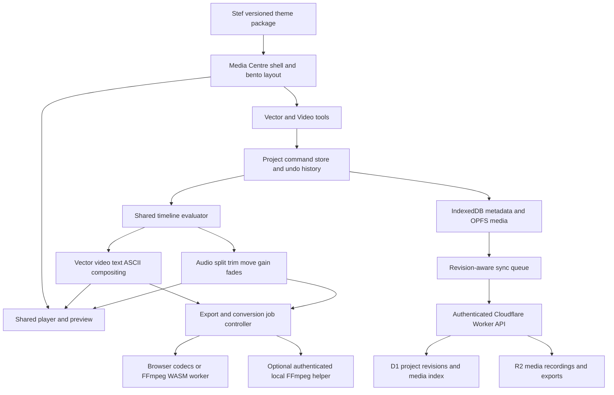

# Media Centre v2 — architecture and build handoff

Status: design proposal, not implemented or validated runtime behaviour. Fresh initiative; no v1 migration/reuse assumption.

Audio Centre series: [Merlin, Elite and Ultimate](AUDIO-CENTRE-SERIES-DESIGN.md) share the same base model, project format and core operations. Proposed tier extensions use configuration/modules within this application rather than separate repositories. Features, functions, processes, operators and structure are documented as distinct branches there. Only the separately authorized retro amp preview is currently implemented.

## Boundaries

Single app repository: shell/player/editor/timeline/shared project core, local persistence, edge API, processor adapters and tests. Stef's design-package repository is a separate optional publishing boundary; no separate player/audio repo. Repository owner, exact project extension and local ports remain unassigned.

Next.js/TypeScript user interface; prefer vinext for the new Cloudflare target in accordance with the current installed skill and Cloudflare guide. It is beta: required routing/base-path and Worker-binding compatibility must pass before build commitment; report incompatibility before changing adapter. No scaffolding/installation is part of this design phase.

## Project model

Logical aggregate: MediaCentreProject with schemaVersion, UUID, user title, created/modified times, revision/baseRevision, output width/height/frameRate, active editing mode, asset manifest, ordered tracks, clips, vector scenes, animations, layout preferences and edit provenance. App UUIDs never substitute for Tower project/session identifiers.

Asset: ID, content hash (computed incrementally), original name, media type, container/codec probe, duration/dimensions, local blob reference, optional R2 key, proxy reference and source/license evidence. Never persist blob: URLs as portable references. File extensions are hints, not proof of decodability.

Clip: UUID, asset or scene reference, track ID, integer timeline start/duration, source in-point, transform, opacity, gain/fades and animation data. Use a documented integer timebase with rational frame rate and sample-accurate audio conversions; round explicitly at media boundaries. No arbitrary code in animation metadata.

Visual and Text tracks composite by explicit layer order; Audio tracks mix. Visual tracks accept image/video/vector/ASCII; text lives on Text tracks by default. Vector mode and Video mode access the same records. Splitting creates two references to the same source, advances the right source in-point and preserves combined duration. Moving is non-destructive. Trimming cannot exceed source bounds; still images have duration without a source-length limit. Overlapping audio mixes; visual overlap follows layer order. Ripple operations are explicit, not default drag behaviour.

Proposed portable save: .svg project wrapper with a safe poster and namespaced metadata containing the complete versioned project manifest. External media is content-hash referenced; offer a package containing the SVG manifest plus media for portable/offline use. File → Save must show whether it saves metadata only or includes media. SVG → Save exports vector artwork, not the whole edit. Validate wrapper metadata/schema and prohibit executable imports. JSON import uses an explicit supported schema/migration path. Final filename conventions are implementation decisions to confirm before format freeze.

## Core interfaces (contracts, not implementation code)

- ProjectCommands: import, insert, split, move, trim, updateScene, delete, undo, redo. One successful command creates one undoable transaction; cancelled/invalid operations leave state unchanged.
- TimelineEvaluator: evaluate project revision at time; return active layers, source timestamps and audio events. Rendering waits for assets/fonts/frames; no mutable playback state as export truth. GSAP is driven from local clip time with resettable property state, rather than wall-clock playback.
- MediaProcessor: probe/import, capability check, convert, extract, export, cancel, progress and cleanup. Report unsupported codec/container combinations without losing the source.
- Persistence: saveLocal/loadLocal/list/relink/package; errors retain current in-memory work. Request persistent storage and report whether granted; downloadable packages remain necessary recovery copies.
- Sync: push immutable media; submit project revision conditional on baseRevision; fetch remote revisions. On conflict preserve both and offer choose/copy/resolve. Never silently last-write-wins.
- Theme: token schema/version, assets, provenance/license and fallbacks. No executable theme scripts.

## Backend and storage flows

Proposed API under /svg/api: project list/get/revision submission, media upload initiation/part completion/download authorization, B-roll search, channel catalog, preferences and sync status. Route deployment must match /svg and /svg/* exactly without taking unrelated /svg-prefixed paths; inspect current site routing before deployment. Preserve both existing www/apex behaviour and store.vistamations.com.

D1 stores project heads/revisions, media indexes, upload sessions and preferences; R2 holds binary media and versioned project manifests where appropriate. Avoid unbounded large project bodies in D1. Only mark an R2 object available after verified upload completion; reconcile orphaned objects/index records. Signed/direct multipart transfer is proposed, with bounded expiry, ownership checks and CORS; interrupted uploads resume or expire without claiming sync success. No automatic deletion of exports/recordings.

Owner-only service authentication. Validate Cloudflare Access JWT issuer, audience and signature (or equivalent reviewed application auth), rather than trusting a client-supplied email header. Confirm actual Access configuration and protect alternate Worker hostnames before release. No public bucket by default. Cache public application assets; exclude authenticated API responses and expiring media credentials from generic service-worker caches.

Optional local helper binds loopback only, uses an explicit pairing credential and strict origin allowlist, validates bounded FFmpeg job parameters, and never accepts arbitrary shell command strings. No wildcard CORS or unauthenticated localhost command execution. Browser-only local/offline editing remains available without the helper, within detected capabilities. Production-to-local bridge needs explicit pairing and compatible browser transport; do not assume HTTPS pages can freely call local HTTP. Native job access is an optional capability, not a dependency for loading a project.

## Processing, offline and imports

Capability report checks actual decoder/encoder configurations, browser storage estimate, cross-origin isolation where needed, and helper availability. Prefer a supported browser pipeline; use FFmpeg WASM within measured resource budgets; offer helper for unsupported/large jobs. MP4 target is H.264/AAC subject to the selected processor's proven support. No promise of unlimited file size or every format. Chunked I/O limits memory pressure but does not eliminate disk/quota/codec constraints. Workers orchestrate storage/auth/search; native FFmpeg processing is not assigned to a Worker request.

Preview and export share the timeline evaluator and compositing rules. Export freezes a project revision, samples exact frame timestamps and mixes audio against the same duration. Segment outputs only with compatible encoding/timestamps and a verified final mux. Report progress by actual stage; cancellation releases memory/temp files while preserving imported sources.

PWA caches versioned shell and explicitly downloaded processors/fonts/assets. IndexedDB metadata, OPFS media and queued sync are origin-local. Localhost and public domain do not automatically share storage; export/import package is the baseline transfer. Same editing behaviour requires the same cached dependencies and media. Online-only: uncached remote media, live IPTV, B-roll search and cloud sync. Surface unavailable capabilities rather than pretend offline parity for network services.

Untrusted SVG: strict sanitization, non-executable metadata parsing, reject scripts/event handlers/foreignObject/external network references, bound complexity, and isolated rendering. Do not directly inline foreign SVG into the app DOM. Imported project URLs cannot initiate arbitrary network fetches. B-roll/IPTV proxy permits configured sources only, blocks private-network SSRF and enforces size/time/redirect limits. Retain item license/source evidence; recording support is channel-specific, with no DRM bypass or presumed blanket recording permission.

## Verification gates for Build

Approved stitching checks: arrange three clips with unequal source in/out points in a chosen order; verify end-to-end timestamps and combined duration, source preservation, collision handling and one-step undo. Repeat with audio-only segments and linked video/audio. Save/package/reopen preserves the sequence. Exported stitched MP4 contains the selected sections in order with measured audio/video continuity; incompatible stream-copy inputs fall back to supported rendering or explain the blocker. Cancellation leaves the editable project intact.

Movement/swap contract: move changes start/track only; swap atomically exchanges the start/track assignments of two compatible clips or matching linked groups while preserving their content and durations. Preflight all affected ranges, track types, locks and third-party collisions before changing state. A rejected swap is a no-op. Insert is a separately named ripple transaction. Build checks cover same-track/cross-track moves, equal/unequal-length swaps, linked audio, forbidden targets, third-clip collision, cancellation, keyboard operation, undo/redo and save/reopen. Verify no unintended trim, time-stretch, source deletion or partial group mutation.

1. Fresh project creates three tracks. Save/package/reopen restores both modes, edits and media; missing media offers relink without deletion.
2. Split a known 10-second audio clip at 4 seconds: 4+6-second segments reference the proper source offsets. Move segments between tracks; undo restores timing. No unintended stretch.
3. Extend a still from 3 to 12 seconds; preview/export duration follows the edit. Video/audio trim respects source bounds.
4. Switch modes repeatedly: media references, track order, duration and undo state remain consistent.
5. Firefox tests prove supported input matrix and MP4 video/audio sync, including cancelled/failed conversion. Record actual hardware/browser; none assumed.
6. Drag/resize tiles and restore presets; keyboard-only split, move and duration editing; six skins retain readable focus/contrast and consistent controls.
7. Offline restart works with downloaded project/media/dependencies. Network return sync preserves concurrent revisions; missing helper is reported accurately.
8. Verify resumable media transfer, ownership checks and D1/R2 reconciliation. Auth spoofing/alternate hosts rejected; secrets absent from bundle/repo/logs; unsafe SVG blocked.
9. IPTV catalog has eight proposed entries and dated NSW test evidence before advertising eight working channels. Record/stop/recover/reimport tested per supported stream. No channel tested by this design work.
10. Verify deployment route isolation and existing store/base app preservation during Deploy, not merely file upload.

## Sources checked and remaining evidence

Checked 2026-11-04 Sydney; documentation informs design, not evidence that this app runs:

- Cloudflare Next.js/vinext guide: https://developers.cloudflare.com/workers/framework-guides/web-apps/nextjs/ — current vinext path and beta compatibility caveat.
- WebCodecs configuration detection: https://developer.mozilla.org/en-US/docs/Web/API/VideoEncoder/isConfigSupported_static — query exact configuration; no assumed codec guarantee.
- Storage persistence: https://developer.mozilla.org/en-US/docs/Web/API/StorageManager/persist — request can be denied.
- FFmpeg WASM FAQ: https://ffmpegwasm.netlify.app/docs/faq/ — resource/performance and dependency-license caveats; review exact shipped build/license inventory during component selection.
- R2 signed transfers: https://developers.cloudflare.com/r2/api/s3/presigned-urls/ — signed object access; multipart design still requires detailed implementation review.

Open before implementation freeze: actual vault retrieval/auth provisioning; selected libraries/version/license inventory; exact project save suffix/package schema; eight IPTV candidates and source-specific recording support; existing store integration evidence; native helper packaging/pairing. These do not authorize silently importing Claude's defaults.

Design quality: **88/100**, self-assessed. Functional boundaries, interactions, data contracts and verification gates are defined. Browser measurements, actual sources, dependency compatibility and credentialed infrastructure remain unverified. No implementation tests claimed. Next phase is Build after Pete's instruction; deployment remains separate Tower release work.
