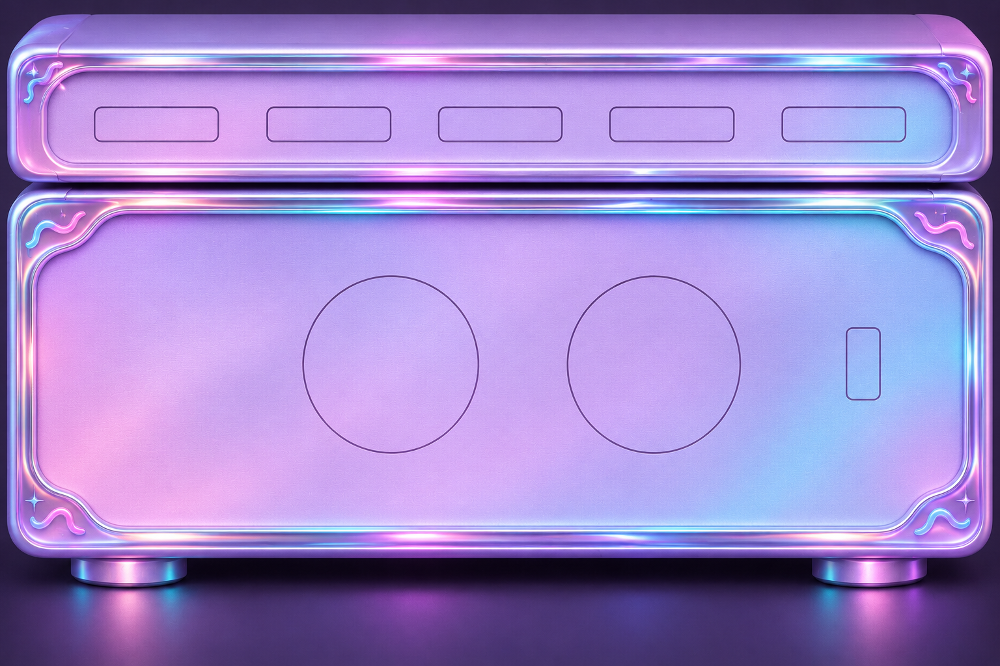
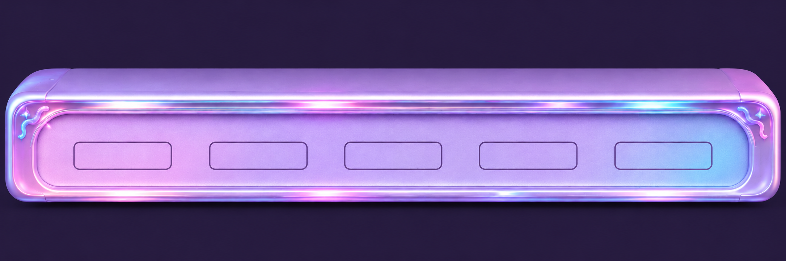
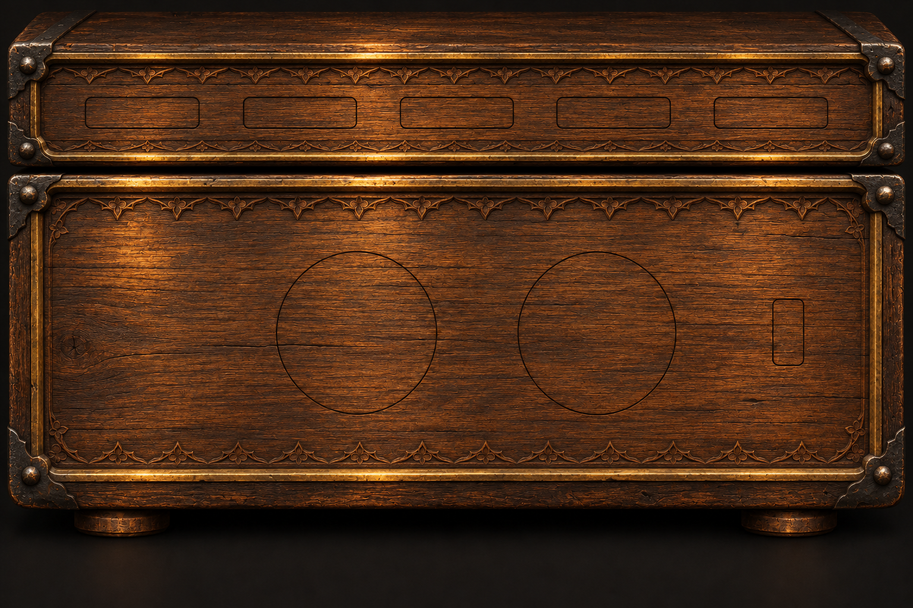
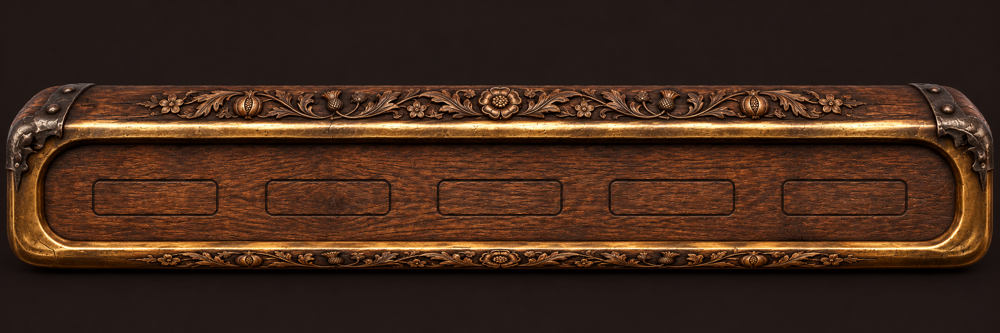

# VISTAMATIONS · Teen Blast and Medieval

Phase: **Design**, entered explicitly by Pete. These are specifications and supplied reference assets, not a new runtime release. The working retro preview at localhost:3216 is not modified by this design.

## Shared base and identity

Both skins use the same base-model features, functions, processes, operators and structure. They can dress **Merlin**, **Elite** or **Ultimate** independently. Teen Blast is not automatically Merlin; Medieval is not automatically Ultimate. Retain the VISTAMATIONS wordmark and Created by Vistamations Media Division credit.

Pete also clarified the surrounding VIS WORLD design as Reality World plus Sim World. The console can be a working utility interface or a simulated world object. Display that context explicitly; decorative/simulated gauges must never masquerade as live component measurements. Detailed world administration is a separate design record, not a new responsibility of the skin.

This is Pete's newer, specific visual direction for these two skins. The supplied pastel and Tudor materials take precedence over earlier generic dark-shell interpretations for these skins. Keep readable text, precise controls and consistent behavior across them.

| Design property | Teen Blast | Medieval |
| --- | --- | --- |
| Materials | Lavender pearl, iridescent chrome, pink/cyan light | Carved Tudor oak, worked iron, aged gold |
| Character | Playful, bright, quick to respond | Patient, crafted, deliberate |
| Knobs | Pearl-silver concentric dials, plum pointer, cyan focus ring | Turned dark-bronze dials, ivory pointer, restrained gold focus ring |
| Switch | Pearl/plum rocker with clear I/O and an independent state lamp | Iron rocker with ivory I/O and independent state lamp |
| Labels | Deep plum on the light faceplate; high-contrast dark detail panels | Ivory on dark inset plaques; do not engrave low-contrast black text into wood |
| Suggested accents | Lavender #B995ED, pink #EE83CF, cyan #8BE9F6; ink #342346 | Oak #4A2819, bronze #A66E32, gold #D8AD62; ivory #F1E3C3 |
| Interaction motion | Brief pearl highlight, short eased knob response | Brief warm metallic highlight, short eased knob response |
| Resting state | Static illuminated artwork; no flashing | Static carved artwork; no drifting embers |

Token values are proposals. Check final rendered contrast against actual artwork before Build acceptance. Typography stays clear for functional labels; decorative lettering is confined to the wordmark/model label.

## Reference boards

### Teen Blast · full stack

### Teen Blast · independent top module

### Medieval · full stack

### Medieval · independent top module

The full-stack images already include a top module. Do not render the separate top image above a full-stack image: that would duplicate the module. Choose either the complete composite with overlays, or independently framed/cropped units for a modular rack. Keep source PNG pixels intact.

## Geometry and alignment

Actual PNG headers checked locally: both independent top modules are **2172 × 724**, both full stacks **1536 × 1024**. The displayed chat preview can have different dimensions; never derive geometry from its display width.

Pete's supplied retro measurements are the reference for alignment between independent units:

| Reference | Bounds |
| --- | --- |
| Top chassis | x 10, y 166, width 2152, height 435 on 2172 × 724 |
| Power amp including feet | x 17, y 200, width 1502, height 703 on 1536 × 1024 |
| Top button slots | x 188 / 567 / 946 / 1325 / 1704, y 376, width 279, height 77 |
| Amp left dial | x 467, y 423, width 268, height 275 |
| Amp right dial | x 872, y 424, width 265, height 275 |
| Amp switch | x 1300, y 504, width 51, height 112 |

For the retro independent top module, exact visible-width scale is **1502 / 2152 = 0.697955…**, approximately Pete's 0.698. At amp canvas width 1536, the top canvas becomes about 1515.96 wide, and its left offset is **17 − (10 × scale) = 10.02**. Scale overlay coordinates with the image; align chassis edges rather than blindly matching canvas widths. Choose vertical position from visible unit bounds, excluding empty background, and leave an intentional rack gap.

The newer Teen Blast/Medieval full stacks visibly use the same broad two-dial/switch arrangement, but their top slots and decorative frames are separate artwork. The retro coordinates are reference measurements, **not verified exact hitboxes for every skin**. At Build, measure each skin's outlines in its native source canvas and save a skin-specific layout map. Do not apply the independent 2172-pixel top-slot coordinates directly to a 1536-pixel composite.

Recommended initial presentation for these two skins: use the supplied full-stack composition to preserve its intended spacing, with independent skin-specific overlay maps. Retain independent top-module assets for the later modular bento/rack layout. No raster recoloring or new generated image is needed for this design.

## Controls and functions

- Left dial: master volume. Right dial: true stereo balance. Rocker: output On/Off. Identical directions, ranges, keyboard actions, units and state across skins.
- Eight vertically aligned health slots occupy the unused left part of the lower amp faceplate. Use a dark inset panel under the labels when necessary for the wood/pearl background. Preserve /100 scores, outstanding todos, source/time, unknown state and audio clipping override.
- Health green/red are functional colors in every skin, independent of pink/cyan/gold decorative highlights. Include words/icons and numeric readings, so color is not the only signal.
- Top module: five horizontal rectangular control slots. **Assignment remains open**; Pete has not answered the earlier slot-mapping question. Proposed mapping is File, Edit, SVG, IPTV, Settings, with existing ASCII access retained elsewhere in the shared navigation. Do not drop ASCII or claim full menus are implemented. Final mapping is a design decision before wiring actions.
- On a narrow screen, retain the visual rack and provide full-size equivalent controls/panels below it. Shrinking an image is not a complete touch/keyboard design. All controls require visible focus, named actions and touch targets sized independently from tiny engraved labels.

## Processes, operators and structure

**Process:** select skin → load supplied assets and validated layout → apply presentation tokens → bind existing shared controls → restore the same project/view state. Switching skin must not restart playback, replace the project or reset todos.

**Operators:** shared split, stitch, move, swap, trim, gain, balance and gate keep their existing semantics. Presentation adds no new signal processing. Never bind decorative animation timing to audio gain or operator completion.

**Structure:** shared base/model → active series configuration → skin assets/tokens/layout map → common UI bindings. Layout belongs to each artwork; operations belong to the base. Keep motion hooks and semantic state outside raster images.

GSAP scope at Build: rotate knob overlay, tilt rocker, transition lamp and acknowledge selection. Use overwrite-safe short tweens, immediate response for reduced motion and no perpetual pulse/flash. Static highlights baked into the supplied PNG are not dynamic indicators of health or output state.

## Build handoff and review criteria

1. Confirm five-slot action mapping before wiring those slots.
2. Verify each skin's native outline map and align overlay centers/edges at desktop and narrow widths.
3. Inspect text, gauge and focus contrast on both backgrounds; use inset labels where needed.
4. Confirm skin switching preserves volume, balance, output state, health/todos and current project.
5. Exercise identical keyboard, pointer and reduced-motion behavior in Firefox; verify no duplicated top module.
6. Report artwork/overlay mismatch before revising the design. Do not advance from Design to full app implementation through this document alone.

Quality: **90/100**, self-assessed design. Asset dimensions and reference scaling are verified; five-slot mapping and skin-specific overlay hitboxes remain open. Images supplied by Pete; no additional open-source license or third-party clearance is asserted for the artwork.
